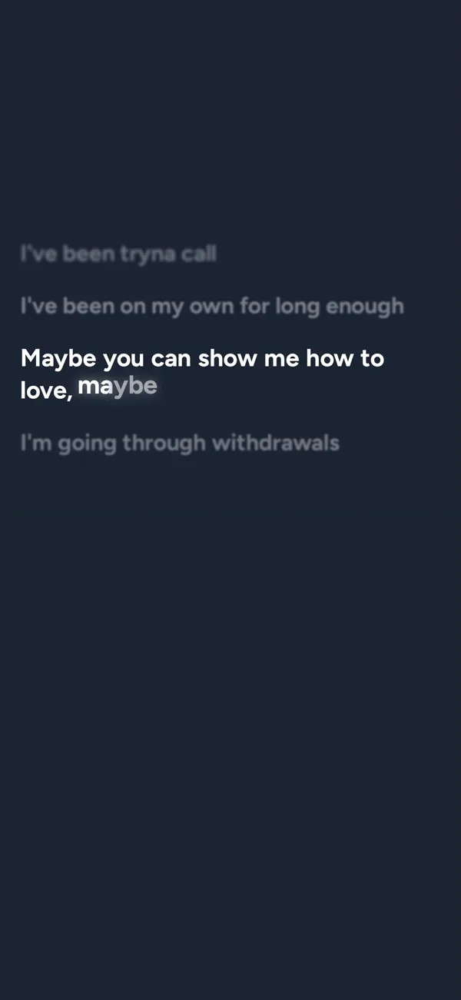
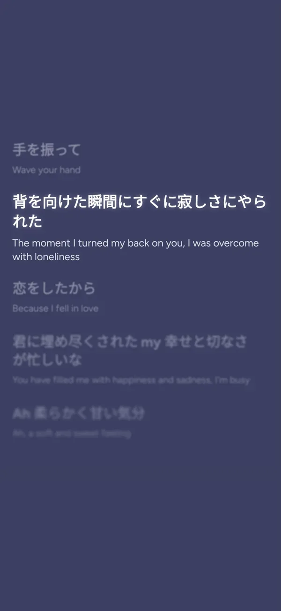
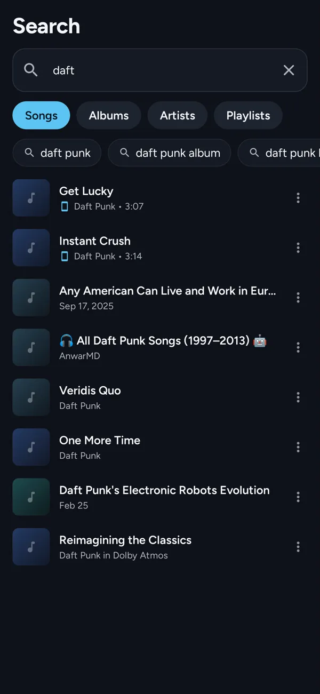
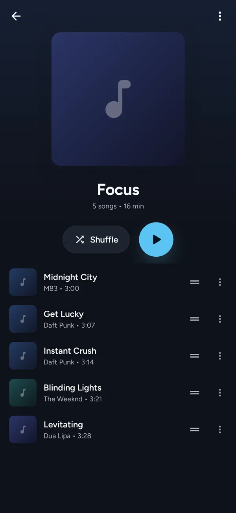

  

<h1 align="center">Pegasus</h1>

  <b>A free music player for Android.</b> 
  The songs on your phone and any song online, with lyrics that light up word by word.

  <a href="https://github.com/KIRAHERK/Pegasus-Free-Online-Music-Player/releases/latest/download/Pegasus.apk"><b>Download Pegasus.apk</b></a>
  &nbsp;·&nbsp;
  <a href="https://kiraherk.github.io/Pegasus/">Website</a>
  &nbsp;·&nbsp;
  <a href="https://github.com/KIRAHERK/Pegasus-Free-Online-Music-Player/releases">All releases</a>

  
  
  
  

Free, no account, no ads. Android 8 or newer.

## Lyrics

- **Word by word.** Each word lights up as it's sung. Songs without word timing light up line by line, and songs without timing still show their lyrics.
- **Translated.** Songs in other languages get an English line under each original line, slang included. One tap turns it on or off. English and Arabic songs stay as they are.
- **Full screen.** Lyrics fill the screen over the cover's moving colours, with the playback controls at hand. Animated album covers can play behind them.

## Music on your phone and online

- **Your library.** Songs, albums, artists, folders, playlists, liked songs and history.
- **Search anything.** Songs, albums, artists and playlists, played straight away. Songs already on your phone come first, marked with a small phone.
- **Share a link.** Share a YouTube, YouTube Music or Spotify song or playlist to Pegasus (or paste it) and it plays, or becomes your playlist.
- **Proper names and covers.** Songs get their real name, artist, album and cover when they play.

## Downloads

- Download a song, an album or a whole playlist.
- Songs arrive in order and a downloaded playlist keeps its order, as a playlist with the same name.
- Saved as real music files in Music/Pegasus, with name, artist and cover, so any music app can play them.
- A song that fails is tried again at the end.

## Tidy library

**Clean up my music** fixes names like `03 - Artist - Song (Official Video) [Lyrics]`, finds proper covers and albums, and hides extra copies of the same song (slowed, live and remix versions stay). You check every change first, your files are never touched, and you can undo it all.

## Sound

Equalizer with presets, bass boost, crossfade between songs, even volume across songs, skip silence and a sleep timer.

## Looks

- The player takes its colours from each song's cover.
- Pick red, green, blue, purple or pink for the rest of the app.
- A queue you can reorder, a mini player you can swipe up, and the lock screen and notification controls you'd expect.

## Recap

Every month: your top songs, artists and albums, the minutes you listened and your longest streak, as cards you tap through and share. It's worked out on your phone; nothing is sent anywhere.

## Install

1. Download [Pegasus.apk](https://github.com/KIRAHERK/Pegasus-Free-Online-Music-Player/releases/latest/download/Pegasus.apk) on your phone and open it.
2. Android asks once whether your browser may install apps. Allow it, then go back.
3. Tap **Install**.

Pegasus keeps itself up to date: it lets you know when a new version is out, and **Settings → Updates** installs it over the old one. Your music, playlists and settings stay.
